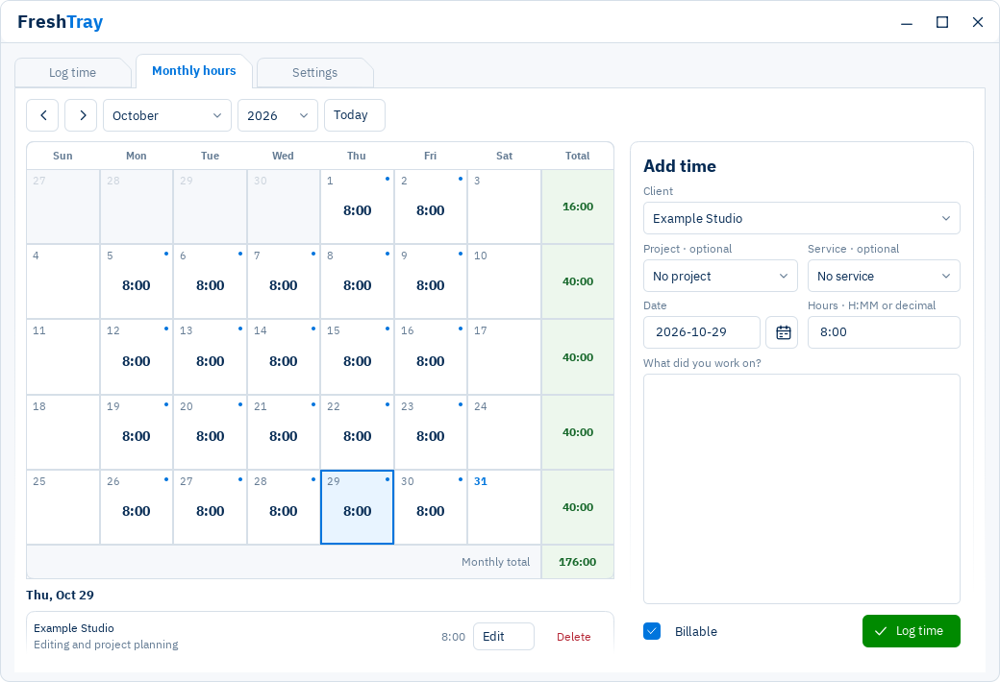

# FreshTray 0.2

A complete overhaul of FreshTray, the Windows tray app for logging time to FreshBooks.

## What's new

- **Rebuilt with Qt Quick.** A new PySide6 / QML interface with responsive layouts, display scaling and smoother panel transitions.
- **A cleaner, cohesive design.** Folder-style tabs, rounded controls, light and dark themes, and a monthly calendar with time-entry editing built in.
- **A better reminder popup.** An animated punchcard, draggable placement that is remembered, a Remind me timer, and separate sound choices for daily and follow-up reminders.

The popup is an app window, separate from Windows notification banners. It can still open when Windows notifications are disabled or Do Not Disturb is on. FreshTray must be running, the popup enabled, and the desktop available. [Reminder details](docs/USAGE.md#reminders).

## Get started

Download [FreshTray 0.2](https://github.com/technicallyalex/FreshTray/releases/tag/v0.2):

1. Download **FreshTray-0.2.exe** from the release's Assets.
2. Keep it in a permanent folder and double-click it. No installer, Python or companion runtime folder is needed.
3. Open **Settings > FreshBooks connection** and follow the [setup guide](docs/SETUP.md). You need your own FreshBooks developer application; no shared credentials are included.
4. Set a reminder time under **Settings > Preferences**, then use **Test reminder**.

Windows 10/11 x64 is required. The executable is unsigned, so Windows may show a publisher warning. Settings and encrypted account data remain in your Windows profile rather than inside the EXE.

Upgrading? Finish syncing pending changes, quit the old copy from its tray menu, and open the new EXE. Existing account settings are reused. If you move the app, update **Start with Windows** from the new location.

## Daily use

Choose a business, client, date, hours and note in **Log time**, or select a day in **Monthly hours** to add, edit or delete an entry there. Common selections are remembered. Settings apply automatically.

Downloaded account lists and calendar months are cached locally. Add, edit and delete entries offline; FreshTray syncs saved changes when the connection returns and asks for review if it detects a conflict or uncertain submission. Connect and open the months you need before going offline.

See the [illustrated usage guide](docs/USAGE.md), [release notes](docs/RELEASE_NOTES.md) and [privacy/security details](docs/SECURITY.md).

## Source and license

[Development and build instructions](docs/DEVELOPING.md). App code is [MIT licensed](LICENSE); fonts, Qt and other runtime components retain their own terms in [third-party notices](docs/THIRD_PARTY_NOTICES.md). This is an independent community app, not affiliated with or endorsed by FreshBooks.

Screenshots use fictional account and time-entry data generated by the included capture script.

## AI disclosure

FreshTray was created with AI assistance for code generation, debugging, documentation, and UI development, as recorded in the original README and release notes. The maintainer confirmed on 2026-10-31 that ChatGPT was used. The records do not map each task to a particular tool or model, identify every affected file, or quantify the proportion of AI-generated material. Additional historical tools, if any, remain unverified.

OpenAI Codex was used for the 2026-10-31 repository audit and to draft these disclosure and licensing documentation changes. This describes this audit only and does not establish earlier Codex use.

AI assistance does not change the project's license or establish rights in third-party code or assets.

OpenAI Codex also assisted with the 0.2 overhaul, testing and documentation.
