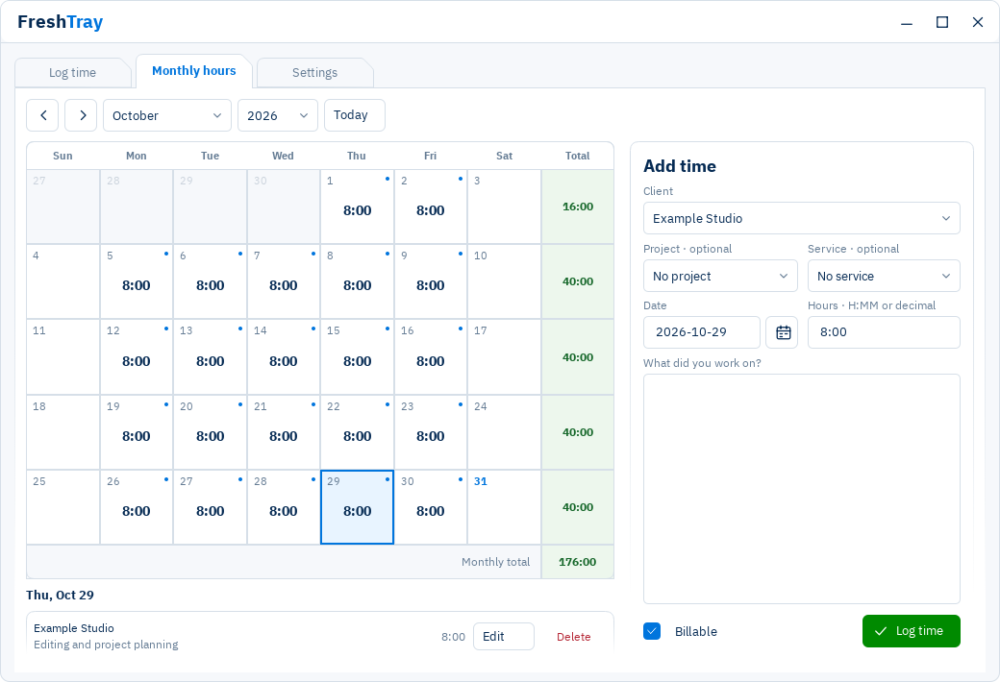

# FreshTray

FreshTray is an application for logging time with your FreshBooks account. Record your work, review your hours in a monthly calendar, and set reminders to keep your time entries up to date.

## What you can do

- **Log your work:** choose a business, client, date, hours and note, with optional project, service and billable status.
- **Manage your hours:** browse a monthly calendar, see weekly and monthly totals, and add, edit or delete entries for a selected day.
- **Get reminders:** choose a daily reminder time, use the Remind me timer, and customize popup sounds and volume.
- **Work offline:** add, edit and delete entries using downloaded account data, then sync your changes when the connection returns.
- **Make it yours:** choose a light or dark theme, remember common selections, and sort choices alphabetically or by recent use.

## Get started

1. Open the [latest release](https://github.com/technicallyalex/FreshTray/releases/latest) and download the FreshTray **.exe** under Assets. The ZIP includes the application with documentation and license notices.
2. Keep the executable in a permanent folder and double-click it. FreshTray is a portable app that doesn't require installation.
3. Open **Settings > FreshBooks connection** and follow the [setup guide](docs/SETUP.md). You need a FreshBooks account and your own FreshBooks developer application; no shared credentials are included.
4. Choose your business and client in **Log time**, enter your hours and note, then select **Log time**.

Requires Windows 10/11 x64. The executable is unsigned, so Windows may show a publisher warning. Settings and encrypted account data remain in your Windows profile rather than inside the EXE.

## Using FreshTray

**Log time** provides a form for recording your work. **Monthly hours** lets you select a day and manage its entries directly beside the calendar. Common selections are remembered between sessions, and settings apply automatically.

Under **Settings > Preferences**, choose a reminder time and use **Test reminder** to preview it. The reminder popup works independently of Windows notification banners. FreshTray must be running with popups enabled and the desktop available. [More about reminders](docs/USAGE.md#reminders).

For offline work, connect and open the months you need before losing internet. Downloaded lists and entries are cached locally. Changes sync when the connection returns; conflicts or uncertain submissions are held for review rather than blindly retried.

See the [illustrated usage guide](docs/USAGE.md) for everyday controls and the [privacy/security details](docs/SECURITY.md) for storage and synchronization behavior.

## Updating

Download the latest executable, finish syncing pending changes, and quit the previous copy before opening the new one. Existing account settings are reused. If you move the application, update **Start with Windows** from the new location. Read the [release notes](docs/RELEASE_NOTES.md) for changes between versions.

## Source and license

[Development and build instructions](docs/DEVELOPING.md). App code is [MIT licensed](LICENSE); fonts, Qt and other runtime components retain their own terms in [third-party notices](docs/THIRD_PARTY_NOTICES.md). This is an independent community app, not affiliated with or endorsed by FreshBooks.

Screenshots use fictional account and time-entry data generated by the included capture script.

## AI disclosure

FreshTray was created with AI assistance for code generation, debugging, documentation, and UI development, as recorded in the original README and release notes. The maintainer confirmed on 2026-10-31 that ChatGPT was used. The records do not map each task to a particular tool or model, identify every affected file, or quantify the proportion of AI-generated material. Additional historical tools, if any, remain unverified.

OpenAI Codex was used for the 2026-10-31 repository audit and to draft these disclosure and licensing documentation changes. This describes this audit only and does not establish earlier Codex use.

AI assistance does not change the project's license or establish rights in third-party code or assets.

OpenAI Codex also assisted with the 0.2 overhaul, testing and documentation.
