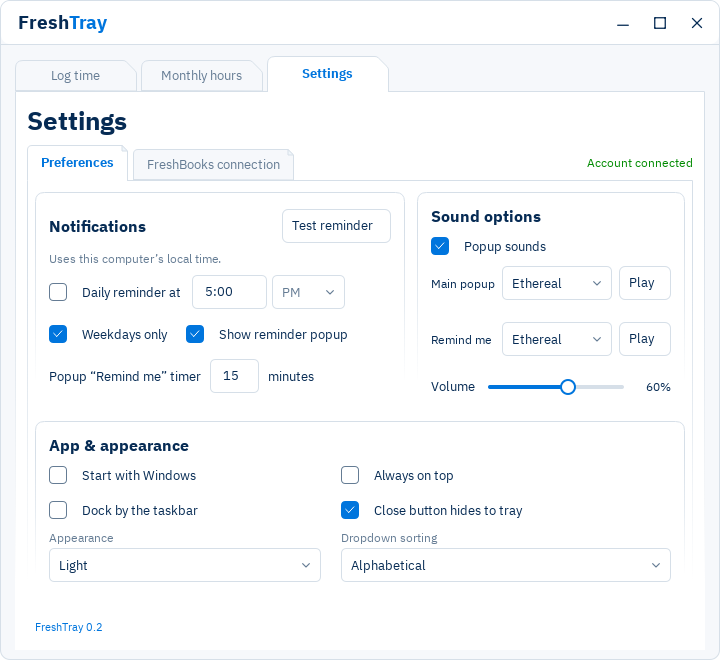

# Set up FreshTray 0.2

## 1. Run FreshTray

Download **FreshTray-0.2.exe** from the 0.2 release Assets when published, save it in a permanent folder, and double-click it. No installation or Python is required. For a local source build, use **Run FreshTray.cmd** after building.

Only one copy runs at a time. If nothing appears, check the hidden-icons arrow beside the Windows clock and click the blue FreshTray icon. Quit an older copy before starting an update.

## 2. Create a FreshBooks developer application

FreshTray needs a FreshBooks account and a developer application you control. It does not include shared login credentials.

1. Sign in to FreshBooks and open its developer area from the [API introduction](https://www.freshbooks.com/api/start).
2. Create an application. Add this exact **Redirect URI**:

   `https://localhost:8765/callback`

3. Add these scopes, then save:

   - `user:profile:read`
   - `user:clients:read`
   - `user:projects:read`
   - `user:billable_items:read`
   - `user:time_entries:read`
   - `user:time_entries:write`

4. Keep the **Client ID** and **Client secret** available. These are for the developer app, not your FreshBooks account password. Keep the secret private.

## 3. Connect in FreshTray

1. Open **Settings > FreshBooks connection**.
2. Paste the **Client ID** and **Client secret** into their fields.
3. Keep **Registered HTTPS redirect URI** set to the exact address you registered above.
4. Click **Open browser sign-in**. Sign in to FreshBooks and approve access.
5. Your browser returns to localhost and shows a connection error. **This is expected:** FreshTray uses a manual return-address step and does not run a localhost web server.
6. Copy the **entire browser address**, including `code` and `state`. Paste it into **Complete return URL from the browser** in FreshTray.
7. Click **Finish connection** within five minutes, then clear the clipboard. The return URL is sensitive and is not saved by the app.

If it expires, start a new attempt. Do not change HTTPS to HTTP, bypass certificate warnings, or use an unrelated callback site. FreshBooks' [OAuth documentation](https://www.freshbooks.com/api/authentication) explains the provider flow.

## 4. Log your first entry

Choose **Log time**, select your business and client, and enter a date, hours and note. Hours accept `8:00` or a decimal such as `7.5`. Project and service are optional. Choose **Log time** and check the entry in FreshBooks.

## 5. Set reminders

Open **Settings > Preferences**. Enable **Daily reminder at**, choose a time and AM/PM, and leave **Show reminder popup** enabled. Choose weekdays only if needed, then use **Test reminder**. Settings save automatically.

**Popup “Remind me” timer** controls the popup's Remind me button. **Sound options** has independent daily and follow-up sound choices, Play buttons and a shared volume slider. Windows master volume and mute still apply.

Enable **Start with Windows** if you want reminders after signing in. FreshTray must be running; it cannot wake a sleeping PC. The popup opens independently of Windows notifications and Do Not Disturb. See [reminder behavior](USAGE.md#reminders) for desktop and timing limits.

## Troubleshooting

- **No clients / access denied:** check the scopes and your FreshBooks account role. Use **Settings > FreshBooks connection > Refresh FreshBooks data** to refresh downloaded lists.
- **Connection failed:** check the exact registered redirect URI and start a fresh sign-in attempt. Never put credentials or a callback URL in a public issue.
- **Entry is waiting or needs review:** keep the app running while connected. Open **Settings > FreshBooks connection** to review sync problems before resubmitting. [Offline help](USAGE.md#offline-work).
- **No popup:** check Daily reminder at, weekdays, Show reminder popup and that the app is running. Use Test reminder. Windows banner permissions are separate from the popup.
- **Sound choices missing:** check the version at the bottom of Preferences. Quit older copies and run 0.2.
- **Moving PCs:** reconnect on the new Windows account. Encrypted account files are tied to the original profile.
- **Uninstalling:** disable startup, disconnect or revoke access in FreshBooks, quit and delete the EXE. Sync pending changes before removing any profile data; see [SECURITY.md](SECURITY.md).
