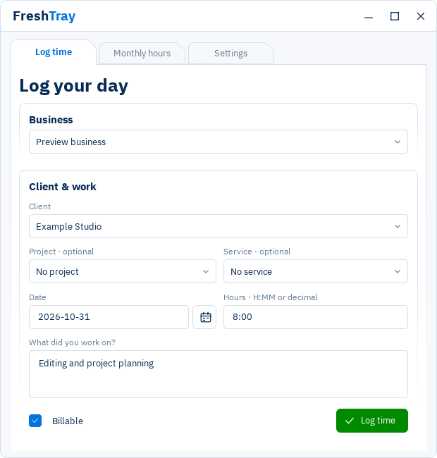
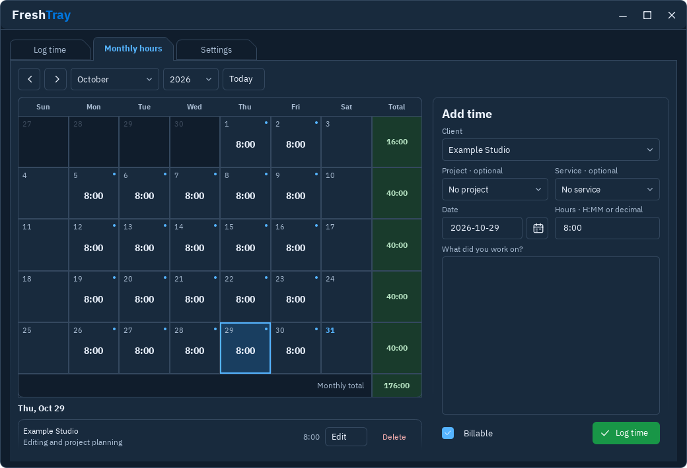
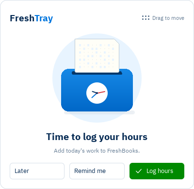

# Using FreshTray 0.2

## Log time

Choose a business and client, then fill in the date, hours and note. Project and service are optional. Set Billable as needed and click **Log time**. A small confirmation appears in the active panel.

Your last business/client are remembered between restarts. In Preferences, **Dropdown sorting** chooses Alphabetical or Recently used. Saved selection history stays on this PC in encrypted account storage. Unsaved form drafts are not persisted across quitting.

## Monthly hours

Use the arrows or month/year selectors to change the month; years are listed newest first. **Today** returns to the current day. Select a date to add time in the adjacent form. Saved entries appear below the calendar with Edit and Delete actions. Confirm a deletion before it is applied.

Dots mark dates with saved entries; multiple dots indicate multiple entries. The green total column shows weekly hours, with the monthly total at its bottom. Days with several entries use pagination; compact windows show one entry at a time to keep the calendar readable. Billed or otherwise restricted entries show their applicable restrictions.

The calendar reuses cached data when switching panels. Downloaded data refreshes in the background. For an immediate refresh, use **Settings > FreshBooks connection > Refresh FreshBooks data**.

## Appearance and window behavior

Settings apply automatically. Choose Light, Dark or System appearance. Enable Always on top or Dock by the taskbar if useful. Docked mode anchors the app beside the taskbar; switching to another app leaves it open. **Close button hides to tray** controls whether X hides the window or quits. Minimize uses the Windows minimize behavior. Right-click the tray icon and choose **Quit FreshTray** to exit completely.

Use Ctrl+1, Ctrl+2 and Ctrl+3 to switch to Log time, Monthly hours and Settings. Layouts fit available desktop space using Qt display scaling; exceptionally small desktops and long dropdown lists still have physical space limits.

## Reminders

In Preferences, enable the daily reminder, select a local time and AM/PM, and choose weekdays only if wanted. Keep **Show reminder popup** on to use the app-owned reminder window.

- **Log hours** opens the entry form.
- **Remind me** schedules another popup using **Popup “Remind me” timer** in Preferences (1–1440 minutes). It does not change the daily reminder time. The timer survives an app restart.
- **Later** dismisses this popup without scheduling another.
- Drag the dotted handle to move the popup. Its location is remembered and kept within the available desktop.

The punchcard animates; the clock hands show the PC's local time when the popup opens. Windows reduced-motion settings reduce animation. In Sound options, choose separate sounds for **Main popup** and **Remind me**, use **Play** to preview, or switch off Popup sounds. The volume slider changes only FreshTray's popup sounds; system mute and volume still apply.

### Windows notifications and timing

The reminder popup is a separate, always-on-top Qt window. FreshTray also attempts a Windows notification banner, but the popup does not wait for that banner or query notification permissions. Turning Windows notifications off or enabling Do Not Disturb does not disable this app-owned window. Microsoft documents that [Do Not Disturb routes notification banners to Notification Center](https://support.microsoft.com/en-us/windows/experience/notifications-and-do-not-disturb-in-windows).

FreshTray must be running. It cannot wake a sleeping computer or display above the lock screen, secure desktop or every exclusive full-screen application. On resume it can catch up once for the current eligible day. The daily schedule is checked about every 15 seconds. Use **Test reminder** to check your setup without consuming the daily reminder.

## Offline work

Connect once and open the months you want available before losing internet. Account lists and downloaded months are cached in Windows-encrypted storage. You can add, edit and delete locally while offline. The app overlays queued changes on the calendar and syncs automatically when it reconnects, checking at intervals of up to a minute after a disconnection.

If you edit then delete an unsynced new entry, its addition is canceled locally. FreshTray checks for changes made elsewhere before updating or deleting. Conflicts and submissions whose outcome is uncertain remain under **Settings > FreshBooks connection** for review. Check FreshBooks before discarding an uncertain local change; it may already exist there. Ambiguous additions are not blindly replayed.

An undownloaded month is marked incomplete. Keep the app running to finish sync, and resolve pending changes before disconnecting, deleting profile files or downgrading. **Disconnect** removes local account credentials and downloaded data after successful disconnection; it does not delete entries already saved in FreshBooks.
